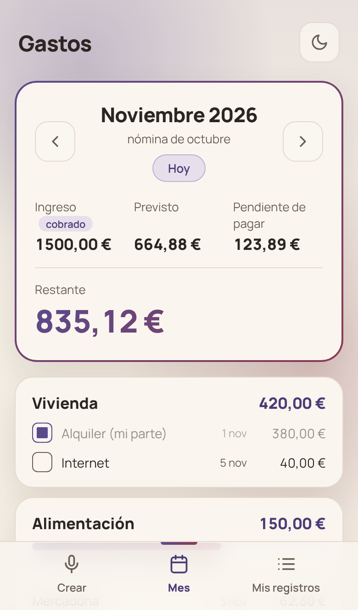
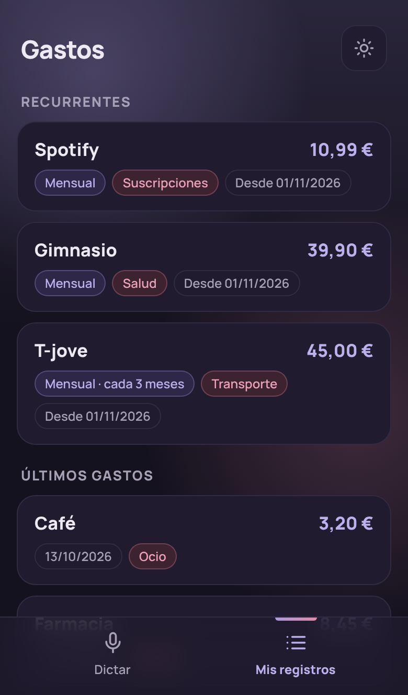
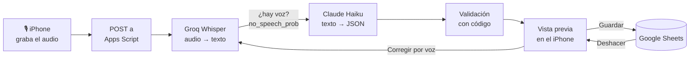

# Gastos por voz

Registra un gasto diciendo *«Spotify 10,99 al mes, ocio»*. Whisper lo transcribe, Claude Haiku lo interpreta
y el código lo valida antes de guardarlo en Google Sheets. Nada se guarda sin que lo confirmes.

<p align="center">
  
  &nbsp;
  
  &nbsp;
  
</p>

**Evaluación con 30 audios reales: 25/30 aciertos y 0 errores silenciosos** (ningún dato erróneo guardado sin
que el sistema pregunte). [Ver la evaluación](#evaluación).

*Capturas con datos inventados.*

---

## El problema

Apuntar gastos a mano tiene tanta fricción que acabo dejando de hacerlo. La **v1** de este proyecto ya
convertía una frase escrita en un registro de Google Sheets: un backend en Google Apps Script la interpretaba
con Claude Haiku y la validaba con código. La **v2** (este repositorio) añade:

- **Dictado por voz** con Whisper (vía Groq), pensado para usarlo en diez segundos desde el iPhone.
- **App propia instalable** (HTML, CSS y JavaScript sin frameworks, servida en GitHub Pages).
- **Mis registros**: ver, editar, dar de baja y eliminar gastos, siempre con *Deshacer*.
- **Mes** (v2.1): el mes elegido con ingreso, previsto y restante, los gastos por categoría y una barra en
  las categorías con presupuesto. [Cómo funciona](#pestaña-mes-la-hoja-como-única-fuente-de-verdad).
- **Categorías propias** (v2.2): crear una categoría con nombre y descripción desde el móvil; la descripción
  le dice a Haiku qué gastos entran. [Cómo funciona](#categorías-la-descripción-también-es-un-prompt).
- **Renombrar y marcar pagos** (v2.3 y v2.6): cambiar el nombre de un gasto y marcar cada gasto del mes como
  pagado o pendiente, con el pendiente de pagar en la cabecera. [Cómo funciona](#marcar-pagos-interfaz-optimista).
- **Ingresos** (v2.4): apuntar la nómina, las comisiones y los extras desde el móvil, con el mes propuesto
  por una regla. [Cómo funciona](#ingresos-un-formulario-no-un-llm).
- **Gasto con formulario** (v2.5): apuntar un gasto escribiéndolo, sin dictar, con la misma validación que un
  dictado. [Cómo funciona](#gasto-con-formulario-otro-proponente-el-mismo-validador).
- **Una evaluación reproducible** para elegir modelo y configuración con datos.

> El código de la v1 (interpretación, validación y escritura en la hoja) no está publicado: vive en el
> proyecto de Apps Script, y la v2 lo usa sin modificarlo.

## Cómo funciona



Todo el sistema se apoya en un principio: **el LLM propone, el código decide y la persona confirma.**

- **Haiku propone.** Devuelve un JSON con un esquema fijo: concepto, importe, categoría, frecuencia, fechas,
  y también *preguntas* cuando algo es ambiguo ("¿Son 19,99 € o 1.999 €?").
- **El código decide.** Comprueba importes, fechas, categorías existentes y duplicados. Si algo no cuadra,
  bloquea el guardado.
- **La persona confirma.** Nada se escribe hasta pulsar *Guardar*, y la última acción siempre se puede deshacer.

Una sola petición (`dictar`) hace audio → texto → interpretación, para pagar una vez el viaje a Apps Script.

## Evaluación

### Método
- **30 audios** grabados una sola vez con Notas de voz y pasados por **6 configuraciones**: 2 modelos de
  Whisper (`large-v3` y `large-v3-turbo`) × 3 vocabularios (ninguno, el completo de la hoja, solo nombres propios).
- **7 grupos de casos:** fáciles, números hablados, marcas, fechas y frecuencias, frases ambiguas (deben
  preguntar), silencio y ruido (deben rechazarse) y condiciones reales (ruido de fondo, voz baja, calle).
- **Mismo camino que un dictado real** (Whisper → Haiku → validación), con un contexto controlado para que el
  resultado no dependa de lo que haya en la hoja ese día. Código: [`backend/Evaluacion.gs`](backend/Evaluacion.gs).

### Resultados

| Configuración | Aciertos | Marca bien escrita | Alucinaciones ante el silencio |
|---|---|---|---|
| **large-v3 · sin vocabulario** ✅ | **25/30** | 19/25 | **0/2** |
| large-v3 · vocabulario completo | 16/30 | 17/25 | 2/2 |
| large-v3 · nombres propios | 21/30 | 18/25 | 1/2 |
| turbo · sin vocabulario | 24/30 | 22/25 | 2/2 |
| turbo · vocabulario completo | 24/30 | 22/25 | 2/2 |
| turbo · nombres propios | 25/30 | 24/25 | 2/2 |

### Lo que importa: cómo falla
Dos configuraciones con 25/30 no son equivalentes si una falla preguntando y la otra inventando. Por eso
cada fallo se clasificó según su efecto:

| Tipo de fallo | Qué ve el usuario | Casos en la configuración elegida |
|---|---|---|
| Pregunta razonable | «¿Qué compraste en Decathlon?» | 2 |
| Marca mal escrita | «Globo» en lugar de «Glovo», visible en la vista previa | 2 |
| Voz real rechazada | «No se ha entendido nada», hay que repetir | 1 |
| **Error silencioso** | Un dato erróneo guardado sin aviso | **0** |

### Hallazgos
1. **large-v3 borra las palabras que recibe como vocabulario.** El vocabulario (el `prompt` de Whisper) es
   texto de contexto, no instrucciones. Con él, «Spotify 10,99 al mes» se transcribió como «10,99 € al mes», y
   lo mismo pasó con Mercadona, Wallapop o Gasolina. También se comía el «ayer», el único origen de errores
   silenciosos de toda la evaluación.
2. **turbo alucina sin dejar rastro.** Ante el silencio escribe «Gracias por ver el video» con una
   probabilidad de «no hay voz» de 0,0, así que ningún umbral puede filtrarlo. Con el vocabulario de nombres
   propios llegó a escribir «Gastos», la primera palabra del prompt. Escribe mejor las marcas (24/25), pero
   su red de seguridad no funciona.
3. **El umbral de silencio está en el límite.** Con large-v3, el silencio da 0,99, el ruido de fondo 0,34 y
   la voz real 0,00–0,24, salvo un caso a 0,39. El umbral se deja en 0,3: repetir una frase es mejor que
   guardar un gasto inventado.
4. **Algunos fallos no dependen de Whisper.** «Diecinueve noventa y nueve» se transcribe «1999» con
   cualquier configuración. Haiku pregunta en lugar de guardar 1.999 €, y decir «diecinueve **con** noventa
   y nueve» lo evita. «Glovo» sale «Globo» incluso con la marca en el vocabulario.

**Decisión:** `whisper-large-v3` sin vocabulario y umbral 0,3.

**Limitaciones:** una pasada por configuración, una sola voz y 30 casos. Las diferencias de 1 o 2 aciertos
son ruido; las conclusiones se apoyan en patrones que se repiten en varios grupos.

## Pestaña «Mes»: la hoja como única fuente de verdad

La hoja de cálculo ya sabe calcular un mes: qué cargos caen en él (mensuales, cada tres meses, cuotas que
terminan), cuánto queda de cada presupuesto y cuál es el restante. Reescribir esa lógica en JavaScript
crearía **dos fuentes de verdad** que tarde o temprano dirían cosas distintas. Por eso la app no calcula
nada: le pide a la hoja el mes y lee lo que sus fórmulas ya han calculado.

**Patrón «leer y restaurar»** ([`backend/Mes.gs`](backend/Mes.gs)). El Resumen calcula un solo mes, el que
está en la celda `B1`, así que la acción `mes`, con un bloqueo para que no haya dos a la vez:
1. Guarda el valor de `B1` y escribe el mes pedido.
2. Fuerza el recálculo y lee la cabecera, la tabla por categoría, los cargos del mes y los gastos puntuales.
3. En un `finally`, vuelve a dejar `B1` como estaba. Aunque algo falle, la hoja no se queda en otro mes.

**Cómo sé que lee bien.** Cada respuesta lleva un control, `cuadra`: la suma de las categorías tiene que dar
el total previsto. Además, una evaluación con tres meses elegidos a propósito comprueba el total y qué
cargos entran y cuáles no:

| Mes | Total | Por qué este mes | Resultado |
|---|---|---|---|
| Noviembre 2026 | 1.239 € | Todo activo, incluida la última cuota de un pago a plazos | ✅ |
| Enero 2027 | 1.115 € | Termina otra cuota; sin el cargo trimestral | ✅ |
| Febrero 2027 | 1.049 € | Vuelve el cargo trimestral; sin las cuotas terminadas | ✅ |

`B1` queda restaurado tras cuatro cambios de mes seguidos. Más tarde, al pasar un cargo de 86 € a su propia
categoría, los tres totales bajaron exactamente 86 € y `cuadra` siguió en ✅: cambiaron los datos de
referencia de la prueba, no el cálculo.

**El coste.** Si `B1` ya está en ese mes, la respuesta tarda ~0,9 s en el servidor. Cambiar de mes obliga a
escribir, recalcular y restaurar: ~1,5–2,5 s en el servidor y ~3 s en el móvil. Es un precio aceptable
para una consulta de solo lectura a cambio de no duplicar la lógica. El otro precio es el **acoplamiento**:
`Mes.gs` depende de la posición de las celdas del Resumen.

**En la interfaz.** Las flechas ‹ › responden a cada toque: el título cambia al instante y la petición sale
300 ms después del último toque (*debounce*), así que tres toques rápidos son una sola petición. Si llegaran
respuestas desordenadas, solo cuenta la última. La app tampoco hace gestos de web: ni zoom por doble toque
o pellizco, ni rebote.

**Meses ya vistos, al instante.** Mientras la app está abierta, cada mes que llega se guarda en memoria. Al
volver a él se pinta enseguida, con «Actualizando…», y se pide igualmente al servidor: si algo ha cambiado (un
gasto dictado, por ejemplo), aparece a los pocos segundos. Así la caché nunca se queda vieja más de una petición
y no hay que acordarse de borrarla en cada acción. El caso delicado era una carrera: si marcas un pago mientras
la actualización viene de camino, esa respuesta es una foto anterior a tu marca y la desharía. Un contador de
cambios por mes la detecta y, en ese caso, manda lo guardado.

## Categorías: la descripción también es un prompt

Desde la pestaña «Crear» se puede añadir una categoría con **nombre y descripción**
([`backend/Categorias.gs`](backend/Categorias.gs)). La descripción es obligatoria (10–150 caracteres) porque
no es decorativa: Haiku lee la pestaña de categorías para clasificar cada dictado.

La prueba que lo confirmó: creé la categoría «Aina» con la descripción de sus gastos y dicté *«luz 30 euros
al mes»* **sin decir la categoría**. Haiku la propuso en «Aina» solo por la descripción. Un dato de la hoja,
escrito por la persona, acaba funcionando como instrucción para el modelo, sin tocar el prompt.

- **El código decide qué se puede crear:** nombre con alguna letra, sin duplicados (sin distinguir
  mayúsculas ni tildes), que no empiece por `=` (se tomaría como fórmula) y que quepa en el Resumen. El
  límite no está escrito en el código: la app cuenta los bloques de categoría del Resumen, así que si se
  amplía la hoja lo detecta sola.
- **La categoría nueva va antes de «Otros»**, para que el cajón de sastre siga al final.
- **Se puede deshacer**, como cualquier otra acción.

## Marcar pagos: interfaz optimista

Cada gasto del mes lleva una casilla de pagado y la cabecera enseña cuánto queda **pendiente de pagar**
([`backend/Pagos.gs`](backend/Pagos.gs)). Los presupuestos no se marcan (no son un cargo). Las líneas pagadas se
atenúan: lo que se ve sin atenuar es lo que queda por pagar.

- **Cada tipo nace en su estado normal.** Un cargo fijo nace pendiente y se marca al pagarlo; un gasto puntual
  nace pagado (casi todos se pagan al momento) y se desmarca si se pagará más adelante. Al apuntarlo con el
  formulario, la casilla «Ya está pagado» permite crearlo directamente como pendiente.
- **Una pestaña aparte, «Pagos»** (mes · ID · fecha · estado), que la app crea la primera vez y que guarda
  **solo lo que se aparta de lo normal**: un fijo pagado o un puntual pendiente. Así no hay una fila por cada
  café y los datos antiguos siguieron valiendo sin migrarlos. No toca ninguna fórmula: es informativo.
- **La clave es mes + ID**, no la fecha del cargo: los cargos semanales no tienen una fecha única en el mes,
  y un «× 4» es una sola casilla.
- **Interfaz optimista.** Apps Script tarda unos 3 s; esperar su respuesta para rellenar una casilla se
  notaría. La casilla y el pendiente cambian al instante y, si el servidor falla (por ejemplo, sin
  conexión), vuelven atrás con un aviso. Funciona porque la acción casi nunca falla y es idempotente:
  marcar dos veces deja una sola fila.
- **Una petición por casilla.** Mientras se guarda, la casilla no responde: con dos toques rápidos, el
  «desmarcar» podría llegar al servidor antes que el «marcar».
- **Sin Deshacer.** Desmarcar es volver a tocar, y así marcar un pago no pisa el Deshacer de la última acción real.
- **Sin marcas huérfanas.** La hoja numera los gastos desde el ID más alto: si se borra el M031, el siguiente vuelve
  a ser M031. En las pruebas, un gasto nuevo heredó así el «pendiente» de uno borrado. El primer arreglo, en el
  móvil, solo cubría el Deshacer; el definitivo está en el servidor: tras eliminar o deshacer, se borran de Pagos
  las filas de gastos que ya no existen, vengan del camino que vengan.

En «Mis registros», además, se puede **cambiar el nombre** de un gasto
([`backend/Renombrar.gs`](backend/Renombrar.gs)). En un cargo recurrente, el nombre nuevo sale en todos los meses.

## Ingresos: un formulario, no un LLM

Los gastos se dictan porque son frases libres y variadas. Los ingresos no: son tres o cuatro al mes, siempre
con la misma forma (nómina, comisiones o extra, importe y fecha). Para eso un **formulario** es más rápido y no
se equivoca, así que aquí no hay modelo ([`backend/Ingresos.gs`](backend/Ingresos.gs)).

- **El mes lo propone una regla y lo decides tú.** La nómina de finales de octubre paga noviembre: si el
  dinero entra a partir del día 20, la app propone el mes siguiente. Se puede cambiar.
- **Menos toques:** en una nómina, el importe es el ingreso previsto de ese mes; el concepto, si se deja vacío,
  se escribe solo («Nómina octubre»).
- **Validar en dos capas.** El móvil avisa antes de enviar (una nómina repetida, o comisiones en un mes sin
  nómina) y el servidor decide: una segunda nómina en el mismo mes se rechaza aunque alguien se salte la interfaz.
- **Una trampa de la hoja, documentada.** El Resumen usa lo cobrado en cuanto un mes tiene algún ingreso; si
  solo estuvieran las comisiones, el previsto dejaría de contar. Como llegan el mismo día que la nómina, no hizo
  falta cambiar la fórmula: basta con el aviso.
- **Efecto en «Mes»:** al apuntar la nómina, el mes pasa de «previsto» a «cobrado» y, si es la del mes
  siguiente, ese pasa a ser el mes por defecto. Lo provoca un dato real, no una fecha fija.
- **De dónde sale el «cobrado».** La cabecera de «Mes» lista los ingresos del mes (concepto · fecha · importe)
  debajo de las cifras. Una prueba exige que sumen justo lo que la hoja cuenta como cobrado, y la ejecuto con
  ingresos de prueba que crea y borra ella misma: con la pestaña vacía, la comprobación solo diría 0 = 0.

## Gasto con formulario: otro proponente, el mismo validador

A veces no se puede hablar. En «Crear» hay también un formulario para apuntar un gasto (concepto, importe,
categoría, frecuencia y fechas) y **no tiene backend propio**: monta el mismo JSON que devuelve Haiku al dictar
y lo envía a la misma acción de guardado. La validación, el ID, la pestaña de destino y el *Deshacer* son los de
siempre.

Funciona porque el diseño separa **quién propone** de **quién decide**: al validador le da igual que la propuesta
venga del modelo o de una persona. Añadir otra forma de crear gastos no ha costado ni una línea en el servidor.

Un detalle que salió al revisar la validación: si la frase nombra exactamente una categoría, manda esa (para que
el modelo no «corrija» lo que dijiste). Si el formulario enviara el concepto como frase, «Regalo Aina» en «Otros»
acabaría en «Aina»; por eso la frase solo nombra la categoría elegida.

## Decisiones técnicas

| Decisión | Alternativa descartada | Por qué |
|---|---|---|
| `whisper-large-v3` sin vocabulario | turbo, o usar vocabulario | La evaluación anterior |
| Filtro de silencio solo en el servidor (`no_speech_prob`) | Medir también el volumen en el móvil (Web Audio) | Lo tuve y lo quité: en el iPhone, tener Web Audio abierto mientras se graba bajaba el nivel del micrófono y bloqueaba dictados reales («No te he oído» tras el primero). El filtro del servidor ya frenaba el silencio (0,99) sin falsos bloqueos |
| Una sola petición `dictar` | Transcribir e interpretar por separado | Cada viaje a Apps Script cuesta ~2 s (medido) |
| `fetch` con `Content-Type: text/plain` y `redirect: 'follow'` | JSON normal | Evita el *preflight* de CORS, que Apps Script no admite, y sigue su redirección |
| Vista previa antes de guardar | Guardar directamente | El modelo puede equivocarse; la persona tiene la última palabra |
| Deshacer de un solo paso, en una notificación flotante | Historial completo | El servidor guarda solo la última acción: más simple y suficiente |
| HTML, CSS y JS sin dependencias | Un framework | Se sirve tal cual en GitHub Pages, sin compilar, y cada línea se puede explicar |
| «Mes» lee lo que calculan las fórmulas de la hoja | Recalcular el mes en JavaScript | Una sola fuente de verdad; cuesta ~1,6 s por cambio de mes |
| Flechas con *debounce* y título que cambia al instante | Bloquear las flechas mientras carga | Con el bloqueo, tres toques rápidos solo avanzaban un mes (lo detecté probando en el iPhone) |
| Descripción obligatoria al crear una categoría | Solo el nombre | Haiku la usa para clasificar los dictados |
| Pagos en una pestaña propia, con clave mes + ID | Una columna en los cargos, o la fecha como clave | No toca las fórmulas y resuelve los cargos semanales, que no tienen fecha |
| Casilla de pagado optimista, con vuelta atrás si falla | Esperar a la respuesta del servidor | Respuesta inmediata con un servidor de ~3 s |
| Pagos guarda solo las excepciones al estado normal (fijo pendiente, puntual pagado) | Una fila por gasto y mes | Casi vacía, sin migrar los datos de antes y sin marcar cada café |
| Limpiar las marcas de gastos borrados en el servidor | Parchearlo en el móvil | Un problema de integridad de datos se arregla donde viven los datos; el parche del móvil solo cubría un camino |
| Caché de meses que enseña lo guardado y a la vez lo actualiza (*stale-while-revalidate*), solo en memoria | Caché pura, o pedir también los meses de al lado por adelantado | La caché pura habría que borrarla en cada guardar, editar o deshacer, y un olvido enseñaría datos viejos; adelantar meses ocuparía la hoja (cada petición escribe `B1`) y retrasaría el mes que quieres ver |
| «Cambiar nombre» con su propio botón | Un único «Guardar cambios» para nombre, importe y categoría | Cada cambio tiene su Deshacer; con uno solo, Deshacer revertiría solo la última de dos operaciones |
| Ingresos con formulario y mes propuesto por la regla del día 20 | Dictarlos, o elegir siempre el mes a mano | Son pocos datos y siempre iguales; el prompt de Haiku es de la v1 y la regla acierta en el caso habitual |
| Corregir un ingreso borrándolo y volviéndolo a apuntar | Un editor de ingresos | Pasa pocas veces; menos código que mantener |
| Dejar la latencia como está tras medirla tramo a tramo | Cachear el contexto de la hoja o calentar Apps Script | La caché ahorraba ~0,3 s tocando código de la v1 y calentar no cambiaba nada (frío ≈ caliente); el grueso (~2 s) es Apps Script |
| Gasto con formulario que reutiliza el guardado de los dictados | Una acción nueva en el servidor, o pasar el texto por Haiku | Una sola validación para todo; sin LLM, lo escrito no se reinterpreta |

## Latencia

Un dictado tarda **4,6 s de mediana** (4,1–5,7 s), medido tramo a tramo en 10 dictados reales: el servidor
devuelve su propio tiempo (`ms_servidor`) y el móvil resta ese dato del total.

| Tramo | Mediana | Peso |
|---|---|---|
| Apps Script: subida, arranque y redirección | 1,98 s | 43 % |
| Claude Haiku + validación | ~1,7 s | 37 % |
| Leer la hoja (contexto para Haiku) | ~0,4 s | 9 % |
| Groq Whisper | 0,36 s | 8 % |
| Resto del servidor | 0,23 s | 5 % |

**Medir antes de optimizar me ahorró un cambio inútil.** Mi plan era cachear el contexto de la hoja, porque
calculaba que costaba ~1 s. Pero esa cifra salía de restar dos medidas tomadas en condiciones distintas. Medido
directamente, cuesta ~0,4 s, así que la caché ahorraría ~0,3 s a cambio de tocar código estable de la v1.
Calentar Apps Script antes de dictar tampoco serviría: en frío tarda casi lo mismo que en caliente. Y el tamaño
del audio no cambia el tiempo de red. Lo que queda es el coste fijo de Apps Script (~2 s) y la variabilidad de
Haiku (con la misma frase, entre 1,3 y 6,5 s). Bajarlo de verdad exigiría sacar la API de Apps Script a otro
servidor, y para una app personal no compensa: lo dejé así a propósito.

En la pestaña «Mes», un mes nuevo tarda ~3 s (detalle en [su sección](#pestaña-mes-la-hoja-como-única-fuente-de-verdad)); volver a uno ya
visto es instantáneo gracias a la caché, que se actualiza por detrás.

## Seguridad

- **Ningún secreto en el repositorio.** Las claves de Groq y Anthropic viven en las propiedades del script.
  El token de acceso se introduce en el móvil la primera vez y se guarda solo en ese dispositivo.
- **El servidor comprueba el token antes de hacer nada.**
- **Validación en el servidor**: no se confía en lo que llega del navegador ni en lo que devuelve el modelo.
- **La salida del modelo se pinta con `textContent`**, nunca con `innerHTML`.
- **Los errores no exponen claves, trazas ni las respuestas de Groq o Anthropic.**

## Limitaciones y siguientes pasos

- **Marcas poco comunes** («Glovo» → «Globo»). Una opción es comparar el concepto con los que ya existen en la hoja.
- **Ajustar el umbral de silencio** con más datos. La app lo sigue midiendo en el modo pruebas.
- **La latencia (~4,6 s) es sobre todo Apps Script y Haiku.** La medí y decidí no optimizarla: lo barato
  ahorraba ~0,3 s y lo que de verdad la bajaría (otro servidor) no compensa en una app personal.
- **Ampliar la evaluación** con otra voz y varias pasadas por configuración.
- **La primera visita a cada mes tarda ~3 s.** Los ya vistos salen al instante, pero la caché se borra al cerrar la app.
- **El Resumen tiene sitio para 12 categorías.** La app respeta el límite y avisa, pero ampliarlo es trabajo en la hoja.
- **Los pagos son informativos.** Marcar un cargo no cambia el restante; solo el pendiente de pagar.

## Qué he aprendido

- **Medir antes de decidir.** El vocabulario parecía una buena idea y en la práctica empeoraba el modelo
  por defecto; sin evaluación no lo habría sabido.
- **Evaluar cómo falla un sistema, no solo cuánto acierta.** Un error que pregunta y uno que inventa
  cuentan igual en un porcentaje, pero no para quien usa la app.
- **El prompt de Whisper no son instrucciones.** Es texto que el modelo imita, y puede colarse en la salida.
- **Un LLM es una pieza más.** La fiabilidad sale de rodearlo de código que valida y de una persona que confirma.
- **Saber dónde está el coste.** La latencia estaba en la infraestructura (Apps Script), no en los modelos.
- **Los datos también son instrucciones.** La descripción de una categoría cambió cómo clasifica Haiku sin
  tocar su prompt.
- **Probar en el dispositivo real y medir.** El fallo del micrófono solo existía en el iPhone; medir el
  volumen durante el fallo descartó mi primera hipótesis y señaló al culpable (Web Audio abierto mientras grababa).

## Estructura y puesta en marcha

```
index.html              página: token, crear (dictar, nueva categoría y nuevo ingreso), mes, mis registros y ajustes
styles.css              estilos; colores como variables para tema claro y oscuro
app.js                  lógica del cliente: grabación, vistas, llamadas a la API
config.js               URL del endpoint de Apps Script (no es secreta)
manifest.webmanifest    para instalarla en la pantalla de inicio
icons/                  icono (SVG fuente y PNG generados)
backend/Api.gs          doPost: enrutador de la API sobre las funciones de la v1
backend/Transcribir.gs  audio → texto con Groq Whisper y filtro de silencio
backend/Vocabulario.gs  vocabulario para Whisper (apagado por defecto tras la evaluación)
backend/Evaluacion.gs   evaluación con audios de Google Drive (se ejecuta desde el editor)
backend/Mes.gs          acción mes: lee el mes de la hoja y restaura Resumen!B1; probarMes() lo evalúa
backend/Categorias.gs   acción categoria: crea una categoría antes de «Otros»
backend/Renombrar.gs    acción renombrar: cambia el nombre de un gasto
backend/Pagos.gs        acción pagar: marca o desmarca un cargo fijo en la pestaña Pagos
backend/Ingresos.gs     acciones ingresos, ingreso y borrar_ingreso: apuntar y borrar ingresos
docs/                   capturas del README
```

1. **Apps Script** (sobre el proyecto de la v1): crea `Api.gs`, `Transcribir.gs`, `Vocabulario.gs`, `Mes.gs`,
   `Categorias.gs`, `Renombrar.gs`, `Pagos.gs` e `Ingresos.gs` con el contenido de `backend/` y añade en las propiedades del script `GROQ_API_KEY`, junto a las de la v1
   (`TOKEN`, `ANTHROPIC_API_KEY`). Crea una implementación nueva como aplicación web.
2. **Frontend:** pon la URL `/exec` de la implementación en `config.js` y publica el repositorio con GitHub Pages.
3. **iPhone:** abre la página en Safari → Compartir → *Añadir a la pantalla de inicio*, y pega el token la
   primera vez.
4. **Evaluación (opcional):** crea `Evaluacion.gs`, sube los audios `01`…`30` a una carpeta de Drive, guarda
   su ID en la propiedad `CARPETA_EVALUACION` y ejecuta `evaluarAudios()`.
