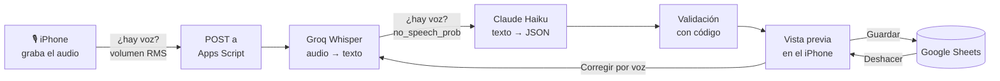

# Gastos por voz

Registra un gasto diciendo *«Spotify 10,99 al mes, ocio»*. Whisper lo transcribe, Claude Haiku lo interpreta
y el código lo valida antes de guardarlo en Google Sheets. Nada se guarda sin que lo confirmes.

<p align="center">
  
  &nbsp;&nbsp;
  
</p>

**Evaluación con 30 audios reales: 25/30 aciertos y 0 errores silenciosos** (ningún dato erróneo guardado sin
que el sistema pregunte). [Ver la evaluación](#evaluación).

*Capturas con datos inventados.*

---

## El problema

Apuntar gastos a mano tiene tanta fricción que acabo dejando de hacerlo. La **v1** de este proyecto ya
convertía una frase escrita en un registro de Google Sheets: un backend en Google Apps Script la interpretaba
con Claude Haiku y la validaba con código. La **v2** (este repositorio) añade:

- **Dictado por voz** con Whisper (vía Groq), pensado para usarlo en diez segundos desde el iPhone.
- **App propia instalable** (HTML, CSS y JavaScript sin frameworks, servida en GitHub Pages).
- **Mis registros**: ver, editar, dar de baja y eliminar gastos, siempre con *Deshacer*.
- **Una evaluación reproducible** para elegir modelo y configuración con datos.

> El código de la v1 (interpretación, validación y escritura en la hoja) no está publicado: vive en el
> proyecto de Apps Script, y la v2 lo usa sin modificarlo.

## Cómo funciona



Todo el sistema se apoya en un principio: **el LLM propone, el código decide y la persona confirma.**

- **Haiku propone.** Devuelve un JSON con un esquema fijo: concepto, importe, categoría, frecuencia, fechas,
  y también *preguntas* cuando algo es ambiguo ("¿Son 19,99 € o 1.999 €?").
- **El código decide.** Comprueba importes, fechas, categorías existentes y duplicados. Si algo no cuadra,
  bloquea el guardado.
- **La persona confirma.** Nada se escribe hasta pulsar *Guardar*, y la última acción siempre se puede deshacer.

Una sola petición (`dictar`) hace audio → texto → interpretación, para pagar una vez el viaje a Apps Script.

## Evaluación

### Método
- **30 audios** grabados una sola vez con Notas de voz y pasados por **6 configuraciones**: 2 modelos de
  Whisper (`large-v3` y `large-v3-turbo`) × 3 vocabularios (ninguno, el completo de la hoja, solo nombres propios).
- **7 grupos de casos:** fáciles, números hablados, marcas, fechas y frecuencias, frases ambiguas (deben
  preguntar), silencio y ruido (deben rechazarse) y condiciones reales (ruido de fondo, voz baja, calle).
- **Mismo camino que un dictado real** (Whisper → Haiku → validación), con un contexto controlado para que el
  resultado no dependa de lo que haya en la hoja ese día. Código: [`backend/Evaluacion.gs`](backend/Evaluacion.gs).

### Resultados

| Configuración | Aciertos | Marca bien escrita | Alucinaciones ante el silencio |
|---|---|---|---|
| **large-v3 · sin vocabulario** ✅ | **25/30** | 19/25 | **0/2** |
| large-v3 · vocabulario completo | 16/30 | 17/25 | 2/2 |
| large-v3 · nombres propios | 21/30 | 18/25 | 1/2 |
| turbo · sin vocabulario | 24/30 | 22/25 | 2/2 |
| turbo · vocabulario completo | 24/30 | 22/25 | 2/2 |
| turbo · nombres propios | 25/30 | 24/25 | 2/2 |

### Lo que importa: cómo falla
Dos configuraciones con 25/30 no son equivalentes si una falla preguntando y la otra inventando. Por eso
cada fallo se clasificó según su efecto:

| Tipo de fallo | Qué ve el usuario | Casos en la configuración elegida |
|---|---|---|
| Pregunta razonable | «¿Qué compraste en Decathlon?» | 2 |
| Marca mal escrita | «Globo» en lugar de «Glovo», visible en la vista previa | 2 |
| Voz real rechazada | «No se ha entendido nada», hay que repetir | 1 |
| **Error silencioso** | Un dato erróneo guardado sin aviso | **0** |

### Hallazgos
1. **large-v3 borra las palabras que recibe como vocabulario.** El vocabulario (el `prompt` de Whisper) es
   texto de contexto, no instrucciones. Con él, «Spotify 10,99 al mes» se transcribió como «10,99 € al mes», y
   lo mismo pasó con Mercadona, Wallapop o Gasolina. También se comía el «ayer», el único origen de errores
   silenciosos de toda la evaluación.
2. **turbo alucina sin dejar rastro.** Ante el silencio escribe «Gracias por ver el video» con una
   probabilidad de «no hay voz» de 0,0, así que ningún umbral puede filtrarlo. Con el vocabulario de nombres
   propios llegó a escribir «Gastos», la primera palabra del prompt. Escribe mejor las marcas (24/25), pero
   su red de seguridad no funciona.
3. **El umbral de silencio está en el límite.** Con large-v3, el silencio da 0,99, el ruido de fondo 0,34 y
   la voz real 0,00–0,24, salvo un caso a 0,39. El umbral se deja en 0,3: repetir una frase es mejor que
   guardar un gasto inventado.
4. **Algunos fallos no dependen de Whisper.** «Diecinueve noventa y nueve» se transcribe «1999» con
   cualquier configuración. Haiku pregunta en lugar de guardar 1.999 €, y decir «diecinueve **con** noventa
   y nueve» lo evita. «Glovo» sale «Globo» incluso con la marca en el vocabulario.

**Decisión:** `whisper-large-v3` sin vocabulario y umbral 0,3.

**Limitaciones:** una pasada por configuración, una sola voz y 30 casos. Las diferencias de 1 o 2 aciertos
son ruido; las conclusiones se apoyan en patrones que se repiten en varios grupos.

## Decisiones técnicas

| Decisión | Alternativa descartada | Por qué |
|---|---|---|
| `whisper-large-v3` sin vocabulario | turbo, o usar vocabulario | La evaluación anterior |
| Doble filtro de silencio: volumen en el móvil + `no_speech_prob` en el servidor | Solo el del servidor | El volumen separa silencio (0,007) y voz (0,086–0,222) por ×10, sin gastar un viaje al servidor. El servidor queda como segunda red |
| Una sola petición `dictar` | Transcribir e interpretar por separado | Cada viaje a Apps Script cuesta ~2,5 s |
| `fetch` con `Content-Type: text/plain` y `redirect: 'follow'` | JSON normal | Evita el *preflight* de CORS, que Apps Script no admite, y sigue su redirección |
| Vista previa antes de guardar | Guardar directamente | El modelo puede equivocarse; la persona tiene la última palabra |
| Deshacer de un solo paso, en una notificación flotante | Historial completo | El servidor guarda solo la última acción: más simple y suficiente |
| HTML, CSS y JS sin dependencias | Un framework | Se sirve tal cual en GitHub Pages, sin compilar, y cada línea se puede explicar |

## Latencia

Un dictado tarda **~6–7 s** de principio a fin:

| Tramo | Tiempo |
|---|---|
| Groq Whisper | ~0,4 s |
| Claude Haiku + validación | ~1,8 s |
| Leer la hoja (contexto para Haiku) | ~1 s |
| Apps Script: subida, arranque y redirección | ~2,5 s |

El modelo de voz no es el cuello de botella; Apps Script sí. La mejora más directa sería cachear el
contexto de la hoja (en una prueba bajó de ~720 ms a 47 ms).

## Seguridad

- **Ningún secreto en el repositorio.** Las claves de Groq y Anthropic viven en las propiedades del script.
  El token de acceso se introduce en el móvil la primera vez y se guarda solo en ese dispositivo.
- **El servidor comprueba el token antes de hacer nada.**
- **Validación en el servidor**: no se confía en lo que llega del navegador ni en lo que devuelve el modelo.
- **La salida del modelo se pinta con `textContent`**, nunca con `innerHTML`.
- **Los errores no exponen claves, trazas ni las respuestas de Groq o Anthropic.**

## Limitaciones y siguientes pasos

- **Marcas poco comunes** («Glovo» → «Globo»). Una opción es comparar el concepto con los que ya existen en la hoja.
- **Ajustar el umbral de silencio** con más datos. La app lo sigue midiendo en el modo pruebas.
- **Bajar la latencia** cacheando el contexto de la hoja.
- **Ampliar la evaluación** con otra voz y varias pasadas por configuración.

## Qué he aprendido

- **Medir antes de decidir.** El vocabulario parecía una buena idea y en la práctica empeoraba el modelo
  por defecto; sin evaluación no lo habría sabido.
- **Evaluar cómo falla un sistema, no solo cuánto acierta.** Un error que pregunta y uno que inventa
  cuentan igual en un porcentaje, pero no para quien usa la app.
- **El prompt de Whisper no son instrucciones.** Es texto que el modelo imita, y puede colarse en la salida.
- **Un LLM es una pieza más.** La fiabilidad sale de rodearlo de código que valida y de una persona que confirma.
- **Saber dónde está el coste.** La latencia estaba en la infraestructura (Apps Script), no en los modelos.

## Estructura y puesta en marcha

```
index.html              página: token, dictar, mis registros y ajustes
styles.css              estilos; colores como variables para tema claro y oscuro
app.js                  lógica del cliente: grabación, detección de silencio, llamadas a la API
config.js               URL del endpoint de Apps Script (no es secreta)
manifest.webmanifest    para instalarla en la pantalla de inicio
icons/                  icono (SVG fuente y PNG generados)
backend/Api.gs          doPost: enrutador de la API sobre las funciones de la v1
backend/Transcribir.gs  audio → texto con Groq Whisper y filtro de silencio
backend/Vocabulario.gs  vocabulario para Whisper (apagado por defecto tras la evaluación)
backend/Evaluacion.gs   evaluación con audios de Google Drive (se ejecuta desde el editor)
docs/                   capturas del README
```

1. **Apps Script** (sobre el proyecto de la v1): crea `Api.gs`, `Transcribir.gs` y `Vocabulario.gs` con el
   contenido de `backend/` y añade en las propiedades del script `GROQ_API_KEY`, junto a las de la v1
   (`TOKEN`, `ANTHROPIC_API_KEY`). Crea una implementación nueva como aplicación web.
2. **Frontend:** pon la URL `/exec` de la implementación en `config.js` y publica el repositorio con GitHub Pages.
3. **iPhone:** abre la página en Safari → Compartir → *Añadir a la pantalla de inicio*, y pega el token la
   primera vez.
4. **Evaluación (opcional):** crea `Evaluacion.gs`, sube los audios `01`…`30` a una carpeta de Drive, guarda
   su ID en la propiedad `CARPETA_EVALUACION` y ejecuta `evaluarAudios()`.
